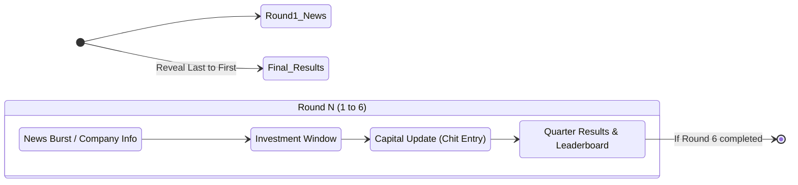

# Product Requirements Document (PRD) — Stock-Up: Guess the Growth

---

## 1. Executive Summary & Objective

**Stock-Up (Guess the Growth)** is a real-time portfolio management and financial simulation platform developed for the **PICT EDC** (Entrepreneurship Development Cell) flagship stock market competition.

The application serves three distinct groups on event day:
1. **Audience / Teams:** Watch market news, real-time market results, and live leaderboard shifts on a centralized projector display.
2. **Event Coordinators:** Rapidly record written investment chits submitted by teams through a streamlined, keyboard-first data-entry interface.
3. **Event Administrator / Organizers:** Advance rounds, broadcast news bulletins, configure team rosters, review audit logs, and trigger the dramatic final standings reveal.

---

## 2. Target Personas & User Roles

| Persona | Role | Primary Interface | Authentication | Key Goals |
|---|---|---|---|---|
| **Audience / Teams** | Participants | [`/display.html`](file:///Users/devesh/Downloads/guess-the-growth/public/display.html) | None (Public) | View company profiles, analyze news cards, check timer countdowns, and track portfolio ranking. |
| **Coordinators** | Data Entry Volunteers | [`/entry.html`](file:///Users/devesh/Downloads/guess-the-growth/public/entry.html) | 4-digit Coordinator PIN | Rapidly input team investment chits, verify balance calculations, and ensure error-free submissions within tight time limits. |
| **Administrator** | Event Lead / Host | [`/admin.html`](file:///Users/devesh/Downloads/guess-the-growth/public/admin.html) | 4-digit Admin PIN | Manage event configuration (teams, news, returns CSV), step the timeline, manage countdowns, and orchestrate results. |

---

## 3. Core Mechanics & Game Rules

### 3.1 Capital & Rounds
* **Starting Capital:** Each team starts with **₹100.00 Cr** in cash.
* **Total Rounds:** 6 financial quarters/rounds.
* **Companies:** 12 listed companies with varying sector profiles and growth trajectories.

### 3.2 Investment Rules
* Teams receive a physical chit each round to write down allocations across any of the 12 companies.
* **Allocation Constraints:**
  * Must be non-negative numbers.
  * Precision: Up to 2 decimal places (in Cr).
  * Total investment in a round cannot exceed current uninvested cash balance.
  * Unallocated funds remain in the team's cash reserves (earning 0% interest).

### 3.3 Compounding Formula & Arithmetic
To avoid floating-point rounding errors (`0.1 + 0.2 !== 0.3`), all portfolio calculations use fixed-point arithmetic scaled by $10^6$ using JavaScript `BigInt`:
$$\text{Investment Value}_{\text{after}} = \text{Allocated Capital} \times (1 + \text{Growth Rate})$$
* **Floor Constraint:** If growth is $\le -100\%$, return is clamped to $-100\%$ (a portfolio position cannot become negative).
* Total team net worth compounds each round:
$$\text{Total Worth}_R = \text{Unallocated Cash}_R + \sum_{c=1}^{12} (\text{Allocation}_{R,c} \times (1 + \text{Return}_{R,c}))$$

---

## 4. Event Lifecycle & State Machine

The event advances through a deterministic timeline of **25 distinct steps** ($6 \times 4 + 1$):

### 4.1 Phase Breakdown per Round
1. **News Phase (`news`):**
   * *Round 1:* "Company Information Release" (default: 20 mins) — display presents cards with company descriptions, founders, and sectors.
   * *Rounds 2–6:* "News Burst" (default: 5 mins) — display showcases market rumors, macroeconomic news, and corporate events.
2. **Investment Window (`investing`):**
   * Default: 10 mins. Teams analyze news and fill in paper chits. Display shows countdown clock.
3. **Capital Update (`entry`):**
   * Default: 5 mins. Coordinators collect chits and record numbers into `/entry.html`.
4. **Quarter Results (`revealed`):**
   * Actual quarterly growth figures are revealed on the projector.
   * Leaderboard recalculates and presents updated standings and net worth deltas.
5. **Final Results (`final`):**
   * Reached after Round 6 Quarter Results.
   * Dramatic reveal: Admin steps through standings from the lowest-ranked team up to the winner (1st place).

---

## 5. Functional Requirements by Interface

### 5.1 Projector Display ([`display.html`](file:///Users/devesh/Downloads/guess-the-growth/public/display.html))
- **Auto-Polling:** Background polling every 2 seconds to reflect phase transitions without manual refresh.
- **Phase-Aware Rendering:**
  - `news` (Round 1): 12-company card grid with sector, logo/initials, and summary.
  - `news` (Rounds 2–6): Dynamic news flash cards.
  - `investing` / `entry`: High-visibility countdown timer with "Investment Window Open" or "Entry in Progress". Company data hidden during active decision phases to avoid leaks.
  - `revealed`: Colored growth percentage tiles (green for positive, red for negative) and full leaderboard table.
  - `final`: Step-by-step podium reveal mode controlled by Admin.
- **Resilience:** Persistent status dot showing network connectivity; alerts operator if connection drops for $\ge 3$ polling cycles.

### 5.2 Coordinator Entry ([`entry.html`](file:///Users/devesh/Downloads/guess-the-growth/public/entry.html))
- **Security:** Protected by 4-digit Coordinator PIN stored in `sessionStorage`.
- **Keyboard-First Workflow:**
  - Quick fuzzy search for team name + `Enter`.
  - Auto-advancing inputs through all 12 companies using `Enter` or `Tab`.
  - Instant live validation showing:
    - Sum of entered investments.
    - Remaining cash balance.
    - Real-time over-budget warning with submission block.
  - `Ctrl + Enter` / `Cmd + Enter` jumps directly to verification read-back and saves chit.
- **Entry Indicators:** Visual indicator of teams whose chits are submitted vs pending for the current round.

### 5.3 Admin Dashboard ([`admin.html`](file:///Users/devesh/Downloads/guess-the-growth/public/admin.html))
- **Security:** Protected by 4-digit Admin PIN.
- **Controls Tab:**
  - Big "Next Phase" action button with confirmation safeguards.
  - Step timeline viewer with current round and phase indicator.
  - "Back" button to undo an accidental phase trigger (with auto-backup snapshot).
  - Countdown timer override (Pause, Reset, +1m, +5m).
- **Setup Tab:**
  - Team setup: Paste multiline list of team names.
  - News editor: Configure up to 6 custom news headlines per round.
  - Returns CSV editor: Upload/edit actual percentage growth matrices.
  - PIN configuration: Change Admin and Coordinator access credentials.
- **Data & Audit:**
  - Export state JSON or CSV leaderboard.
  - View real-time immutable audit trail (who did what, when).

---

## 6. Non-Functional Requirements

1. **Zero External Runtime Dependencies:** Node.js standard libraries only (`http`, `fs`, `crypto`, `os`, `path`). Zero npm install overhead on event laptops.
2. **Extreme Low Latency:** Polling responses under 15ms. In-memory state caching backed by atomic filesystem writes.
3. **Data Integrity:** BigInt fixed-point arithmetic guarantees 0.000000% calculation discrepancies.
4. **Failure Recovery:** Snapshot backup created automatically before every state transition or override.
5. **Offline/LAN Capability:** Full functionality without public internet connection when hosted over a local Wi-Fi router.
